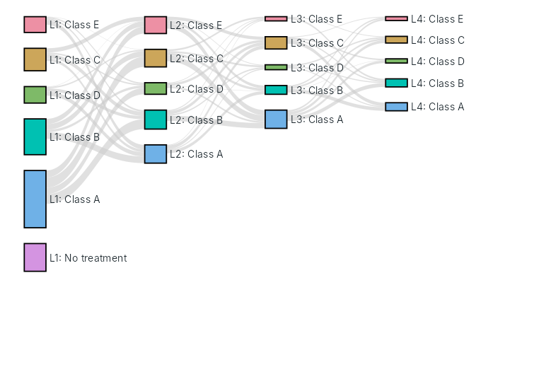
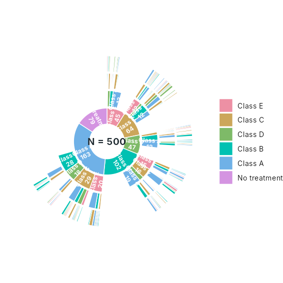
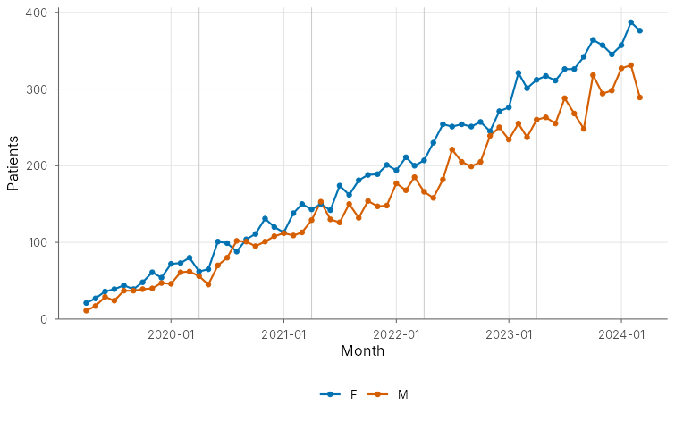
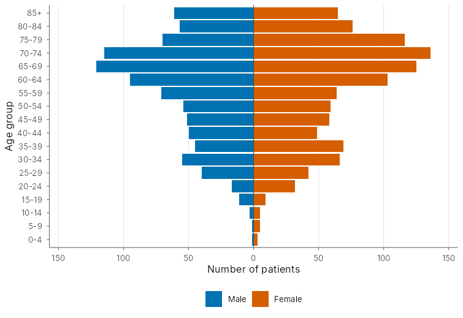
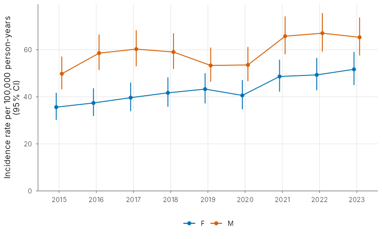
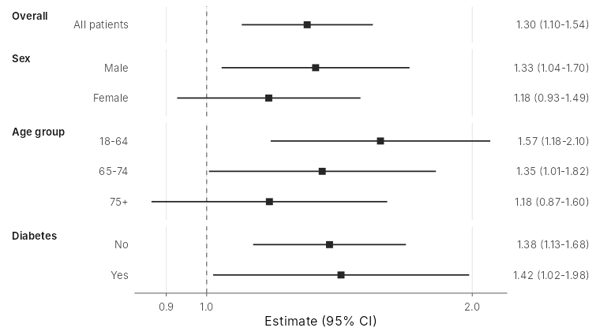
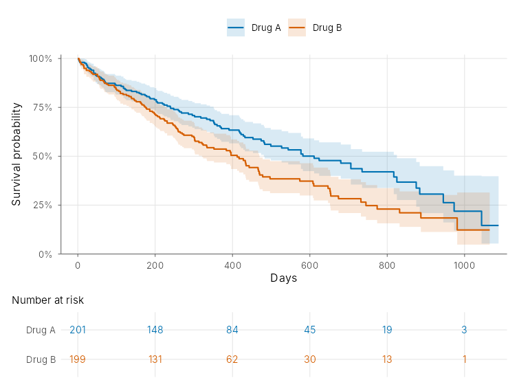
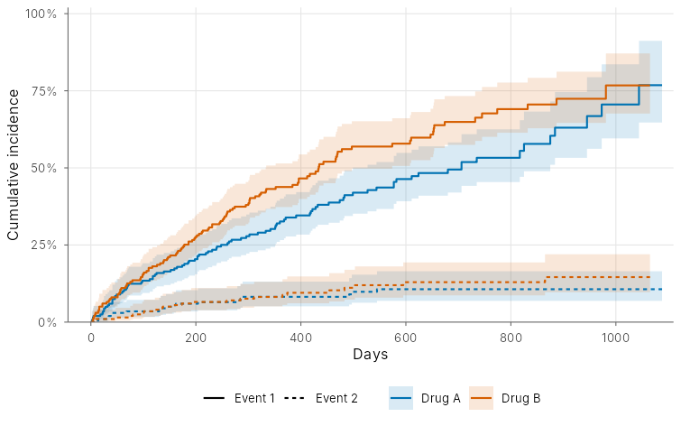
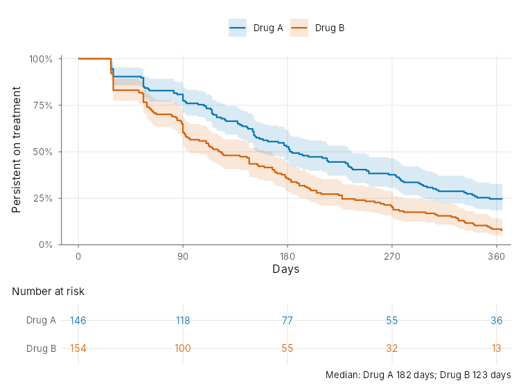
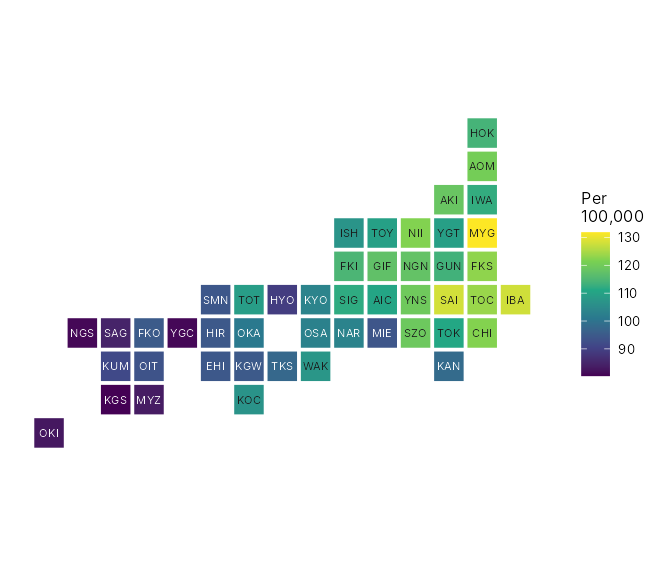

# sanpo

<!-- badges: start -->
[](https://github.com/ichirio/sanpo/actions/workflows/R-CMD-check.yaml)
<!-- badges: end -->

**Plots for epidemiology on Japanese claims and medical databases.**

*sanpo* (散歩, "a walk") follows the patient journey: what patients were
treated with, in which order, how many there were over time and how long
they stayed on treatment. Each figure is a static `ggplot2` plot with good
defaults, drawn in one call from patient-level data.

It is a sibling of [rtfreporter](https://github.com/ichirio/rtfreporter)
(RTF output) and [tflspec](https://github.com/ichirio/tflspec)
(specification-driven clinical TFLs).

> Status: early development (phase 1: the release-1 plot collection). The
> API may still change.

## Installation

```r
# install.packages("remotes")
remotes::install_github("ichirio/sanpo")
```

## The plots

Every figure is drawn in one call from made-up example data below. All
example data in the package are synthetic (`sp_synth_*()`); nothing comes
from a real database.

```r
library(sanpo)
```

### Treatment-pathway Sankey

```r
lot <- sp_synth_pathways(n = 500)   # patient_id, sex, line, drug_class
sp_sankey(lot)
```



A selling point of the Sankey: **it can draw nodes that have no links.**
Nodes are laid out from the node table rather than inferred from the links,
so a group that no patient enters or leaves (in the example data, patients
whose only "line" is *No treatment*) is still drawn at its own size. Tools
that infer the nodes from the links cannot show such a group.

### Treatment-pathway sunburst

```r
sp_sunburst(lot, center_label = "N = {n}")
```



### Trends over time

Monthly counts of distinct patients, with the start of each fiscal year
(April) marked; `unit = "fiscal_year"` counts by fiscal year instead.

```r
claims <- sp_synth_claims(n = 2000)  # patient_id, sex, age, pref_code, claim_ym
sp_trend(claims, by = "sex")
sp_trend(claims, unit = "fiscal_year", by = "sex")
```



### Age-sex pyramid

5-year bands with an open top band (`top = 85` gives `"85+"`).

```r
patients <- claims[!duplicated(claims$patient_id), ]
sp_pyramid(patients)
```



### Rates with confidence intervals

Incidence rates with exact Poisson intervals (or Byar / normal), or
prevalence with exact binomial intervals.

```r
sp_rate(sp_synth_rates(), by = "sex", per = 1e5)
```



### Forest plot

```r
sp_forest(sp_synth_estimates(), group = "group")
```



### Kaplan-Meier and cumulative incidence

Kaplan-Meier with the number at risk as a separate panel, and the
Aalen-Johansen cumulative incidence when there are competing risks (status
0 = censored, 1 = event, 2 = death), both from `survival::survfit()`.

```r
surv <- sp_synth_survival(n = 400)
sp_km(surv, group = "group", risk_table = TRUE)
sp_km(surv, status = "status_cr", group = "group")
```





### Persistence on treatment

Prescription fills are joined into episodes with an allowed gap
(`sp_episodes()`), then time to discontinuation is drawn as a Kaplan-Meier
curve.

```r
rx <- sp_synth_rx(n = 300)          # patient_id, drug, fill_date, days_supply
sp_episodes(rx, gap = 30, by = "drug") |>
  sp_persistence(group = "drug", risk_table = TRUE)
```



### Prefecture tile map

The 47 prefectures as equal tiles; no boundary data needed.

```r
sp_pref_tile(sp_synth_pref(), value = "rate", legend_title = "Per\n100,000")
```



### Saving for a journal

```r
p <- sp_pyramid(patients)
sp_save(p, "pyramid.tiff", size = "single", dpi = 600)  # LZW-compressed TIFF
sp_save(p, "pyramid.svg")
```

## No hidden steps

Every figure is a data function and a plot function, and the one-call
function only chains the two. The table drawn is kept in
`attr(, "sp_data")`, so the numbers in a figure can be checked or exported.

| One call           | Data                    | Plot                                         |
|--------------------|-------------------------|----------------------------------------------|
| `sp_sankey()`      | `sp_sankey_data()`      | `sp_plot_sankey()`, `sp_plot_sankey_batch()` |
| `sp_sunburst()`    | `sp_sunburst_data()`    | `sp_plot_sunburst()`                         |
| `sp_trend()`       | `sp_trend_data()`       | `sp_plot_trend()`                            |
| `sp_pyramid()`     | `sp_pyramid_data()`     | `sp_plot_pyramid()`                          |
| `sp_rate()`        | `sp_rate_data()`        | `sp_plot_rate()`                             |
| `sp_forest()`      | `sp_forest_data()`      | `sp_plot_forest()`                           |
| `sp_km()`          | `sp_km_data()`          | `sp_plot_km()`, `sp_plot_risk_table()`       |
| `sp_persistence()` | `sp_persistence_data()` | `sp_plot_persistence()`                      |
| `sp_pref_tile()`   | `sp_pref_tile_data()`   | `sp_plot_pref_tile()`                        |

Design choices:

* Static `ggplot2` plots; the result is an ordinary `ggplot` you can add to.
* Labels default to English (`lang = "en"`); Japanese is one option away
  (`lang = "ja"`, or `options(sanpo.lang = "ja")`).
* Okabe-Ito colours by default (`sp_palette()`), readable in print.
* Light dependencies: `ggplot2`, `dplyr`, `rlang`, `tidyr` and `survival`.

Later phases: small-cell suppression (off by default, selectable), Excel
output through `openxlsx2` and RTF output through `rtfreporter` (both
optional).

## Contributing

See [CONTRIBUTING.md](CONTRIBUTING.md). Issues and pull requests are welcome.

## License

Apache License 2.0.
